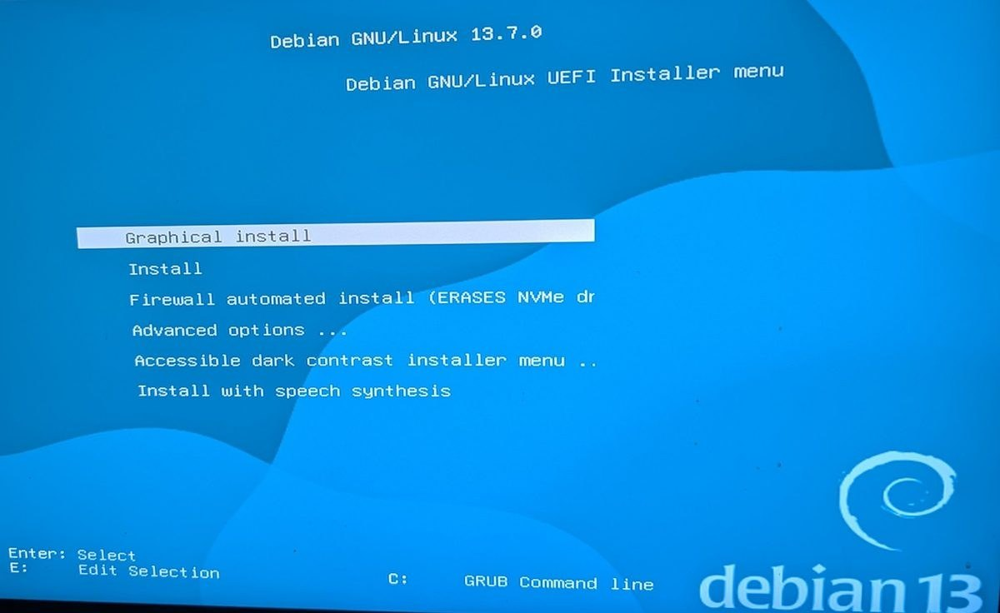
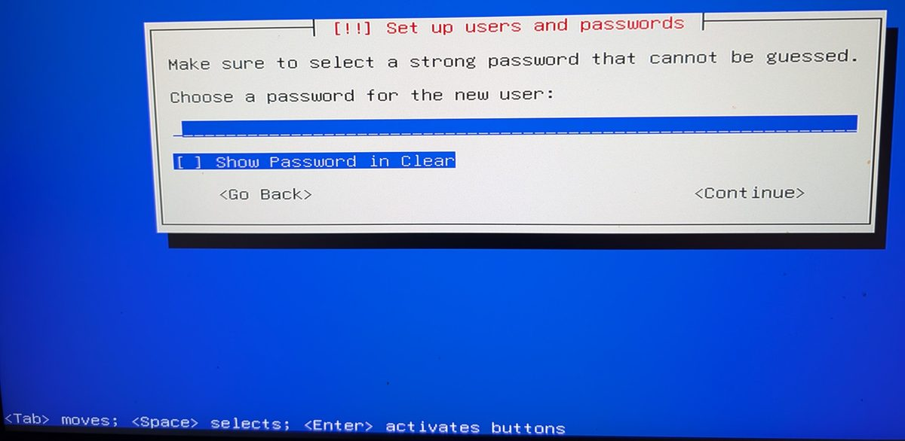
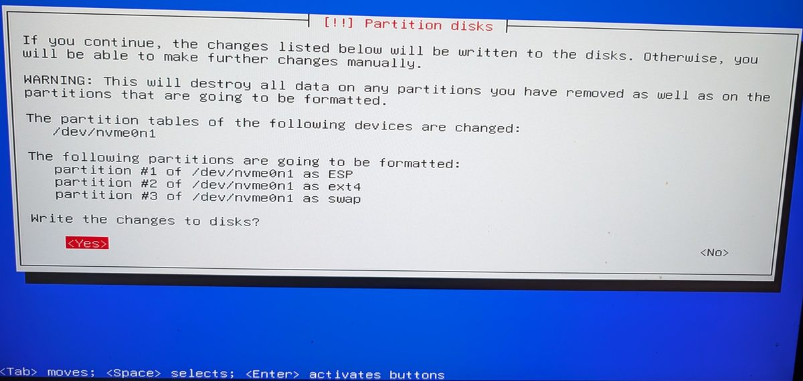
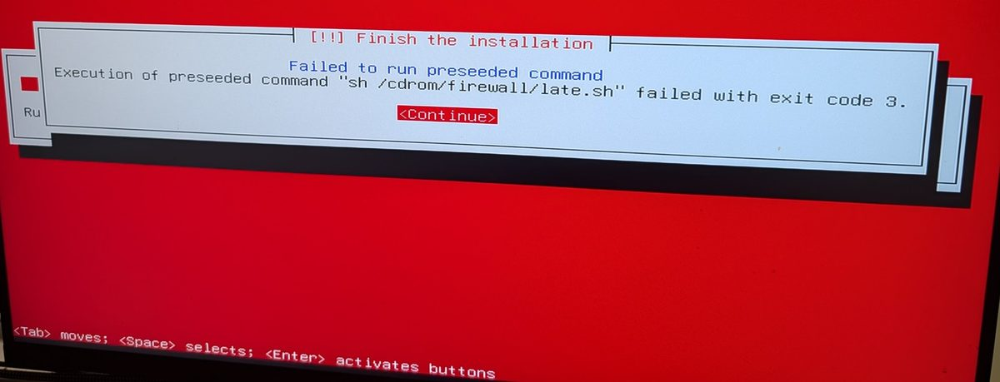

# Install the firewall from the USB stick

You need the USB stick from [BUILD.md](BUILD.md), a screen and a keyboard on the firewall machine, and a network
cable to a LAN that has internet access and a DHCP server (your present router). The install downloads its
packages from `deb.debian.org`. It takes 15 to 25 minutes.

The install **erases the disk** named in `INSTALL_DISK`. At this stage the box is only a computer on your LAN.
It does not route anything until you deploy a profile (`firewall/README.md`) and do the cutover
(`firewall/CUTOVER.md`).

## Before you start

- Choose a password for the user `fwadmin` and keep it in a password manager. It is for the console; SSH uses
  the key only.
- Connect the network cable to the **onboard** port, not to a port on the add-in card.

## Steps

1. Plug in the USB stick, switch the machine on and open the boot menu (F12 on a ThinkCentre). Pick the USB
   entry; take the UEFI one if the stick shows twice.
2. In the installer's menu pick **Firewall automated install (ERASES NVMe drive)**. The stock "Install"
   entries are still there; they start the normal Debian installer and use none of the settings here.

   

3. The installer asks three things:
   - the password for `fwadmin`, twice;

     

   - **Write the changes to disks?** Check that the list shows the disk you mean, then answer Yes. This
     erases it.

     

4. It installs, runs the bootstrap and restarts by itself. Take the stick out when the screen goes dark. If
   the installer's menu shows again, the machine started from the stick: take it out and restart. The menu
   starts nothing by itself.
5. Find the address the box got: look for the host name `firewall` in your router's client list. Then log in
   from the computer that holds the key:

   ```sh
   ssh -i ~/.ssh/firewall_ed25519 fwadmin@<address>
   ```

6. Read the bootstrap log. The last line must be `bootstrap done`, and a line with `WARNING` names a step to
   repeat by hand:

   ```sh
   sudo cat /var/log/firewall-bootstrap.log
   ```

If the machine does not match the model guard (`HW_MODEL_REGEX`), the installer stops at the start with an
error and changes nothing. The disk name `/dev/refused-not-a-thinkcentre-tiny` in a message comes from that
guard.

If the install ends with a red screen that says the command `sh /cdrom/firewall/late.sh` failed, the
bootstrap script stopped with an error. Debian is on the disk, but the box is not set up. Do not go on from
there. Press Alt+F2 for a shell, read the end of `/target/var/log/firewall-bootstrap.log` to see which step
failed, fix the cause and run the install again.



## What the box has after the install

- Debian 13 with the SSH server. Security updates install by themselves (`unattended-upgrades`).
- SSH: key login only, user `fwadmin` only, no root login.
- `fwadmin` has sudo **without a password**, so that an agent can manage the box over SSH. To make sudo ask,
  remove `/etc/sudoers.d/10-fwadmin`.
- A first ruleset in `/etc/nftables.conf`: SSH and ping from private addresses are allowed, everything else
  inbound is dropped, nothing is forwarded.
- `fw-apply` and `fw-confirm`. `sudo fw-apply FILE` loads a ruleset and puts the old one back after 120
  seconds unless `sudo fw-confirm "reason"` runs first. A mistake in the rules cannot lock you out for longer
  than that.
- Installed and **switched off** until a profile configures them: dnsmasq (DHCP and DNS), unbound (DNS
  resolver), Suricata 8 (from trixie-backports).
- Tools: nftables, rsyslog, chrony, git, jq, tcpdump, conntrack, ethtool, iperf3, smartmontools, nvme-cli,
  lm-sensors, python3, DuckDB.
- `/etc` is under git (etckeeper), with the identity from `ETC_GIT_NAME` and `ETC_GIT_EMAIL`.
- Claude Code from its signed apt repository, kept current with the other updates, plus `bubblewrap` and
  `socat` for its command sandbox.
- A user `fleet` (no sudo, no SSH login, may read logs) and `fleet-member.service` for analysis jobs. The
  service stays inactive; `agent/README.md` says what it is for and how to remove it.
- A persistent journal, and the bootstrap files in `/opt/firewall-bootstrap`.

## Notes

- **Port name on the M920q.** The BIOS counts the onboard Wi-Fi as a network port. With Wi-Fi on in the BIOS
  the onboard Ethernet port is `eno2`; with Wi-Fi off it is `eno1`. The bootstrap configures both names for
  DHCP, so the box keeps its address when that BIOS setting changes. `deploy.sh` later fixes the name by MAC
  address.
- **Suricata.** Debian 13 ships Suricata 7, which has open security issues, so the bootstrap takes version 8
  from trixie-backports. If the log has `WARNING: suricata install failed`, run
  `sudo apt install -t trixie-backports suricata` and then `sudo systemctl disable suricata`.
- **Claude Code.** If the log has `WARNING: claude-code install failed`, run
  `sudo apt update && sudo apt install claude-code`.
- **Installing again.** The same stick installs again from zero: it erases the disk. Save what you need from
  the box first (`firewall/README.md` describes the backups).

Next: `firewall/README.md`, to check and deploy the bench profile.
